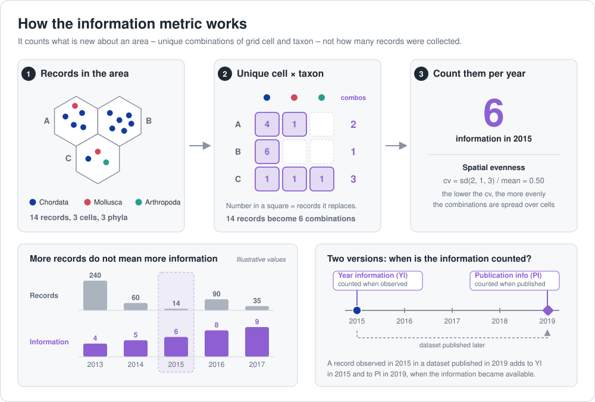
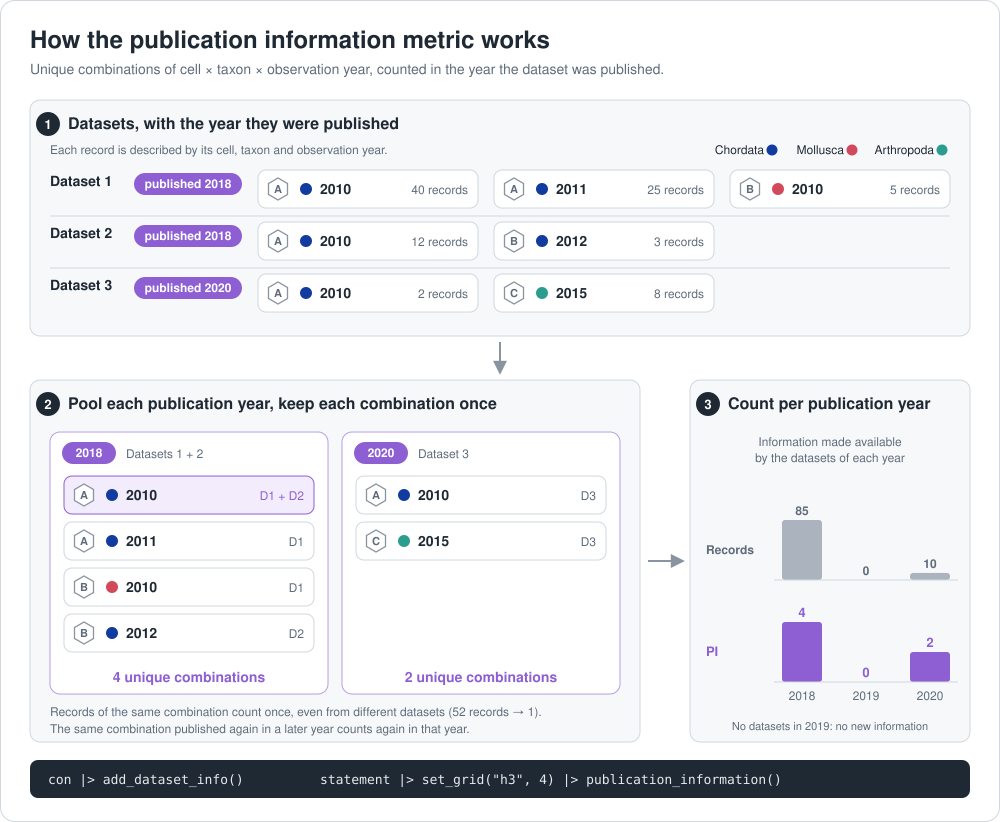

# abra

OBIS Area-Based Records Analysis: tooling for running area/period/depth/taxon
filtered analyses on the OBIS open data (a local copy of the DuckDB-compatible
Parquet files), aggregating the results onto a spatial grid (H3), and reporting on
them in an interactive dashboard or a PDF report.

```
OBIS open data ──► abra (R package) ──► prepare-data.R ──► Parquet files ──┬──► dashboard (web page)
                                                                         └──► Quarto report (PDF)
```

## Repository layout

| Folder | What it is |
|---|---|
| [`r-package/`](r-package/) | The `abra` R package: chain `set_area()`, `set_period()`, `set_depth()`, `set_filters()` and `set_grid()` onto a `robisdb` connection, then run analyses (`basic_stats()`, `records_by_year()`, `publication_information()`, ...). See [`r-package/README.md`](r-package/README.md). |
| [`dashboard/`](dashboard/) | A static web dashboard (SvelteKit) with the results of **one analysis for one area**. No server needed: it can be hosted for free on GitHub Pages. Includes `prepare-data.R`, the script that runs the analysis. See [`dashboard/README.md`](dashboard/README.md). |
| [`quarto/`](quarto/) | A [Quarto](https://quarto.org) document that renders the same results as a PDF report. See [`quarto/README.md`](quarto/README.md). |
| [`dev/`](dev/) | Exploratory scripts and examples; not part of the package. [`dev/example-r/`](dev/example-r/) is an analysis in R; [`dev/full-example/`](dev/full-example/) takes it all the way to a dashboard and a report for three groups of taxa. |
| [`python-package/`](python-package/) | A Python package, planned but not started. |

## Requirements

- **R** (4.1 or newer) with the `abra` and [`robisdb`](https://github.com/iobis/robisdb)
  packages (see below).
- **A local copy of the OBIS open data.** Get it with `robisdb::sync_opendata()`. The
  analyses need a local copy: streaming from S3 works but is very slow.
- For the dashboard: [Node.js](https://nodejs.org) 20 or newer.
- For the report: [Quarto](https://quarto.org/docs/get-started/) 1.4 or newer.

## Install the R package

```r
# install.packages("pak")
pak::pkg_install("iobis/robisdb")
pak::pkg_install("iobis/abra/r-package")
```

## Use the R package

```r
library(robisdb)
library(abra)

con <- connect_opendata_local("path/to/obis_data")

result <- con |>
  set_area("POLYGON ((-46 -24, -42 -24, -42 -20, -46 -20, -46 -24))") |>
  set_period("2000-01-01", "2020-12-31") |>
  set_grid("h3", 4) |>
  run_analyses(c("basic_stats", "records_by_year", "species_list"))

result$basic_stats
```

See [`r-package/README.md`](r-package/README.md) for all the setters and analyses.
For a longer example, with several groups of taxa in the Mediterranean Sea, see
[`dev/example-r/example-eov-med.R`](dev/example-r/example-eov-med.R).

## The information metric

The *year information* (`year_information()`) and *publication information*
(`publication_information()`) metrics measure how much is known about an area, not
how many records were collected. They count the **unique combinations of grid cell
and taxon** (by default phylum; see `set_taxonomic_level()`) per year, so a place
sampled thousands of times for the same group counts once. The first groups them by
the year of observation; the second by the year the dataset was published.



The publication version needs the date each dataset was published (see
`add_dataset_info()`). It pools the datasets published in the same year and counts
the unique combinations of cell, taxon and **observation year** among them, so it
shows how much new information the community made available each year:



## Make a dashboard and a report

The dashboard and the report show exactly the same results, because both read the
files written by one script, [`dashboard/prepare-data.R`](dashboard/prepare-data.R).
The workflow is:

**1. Run the analysis for your area.** Edit the settings at the top of
`dashboard/prepare-data.R` (title, area, period, depth, taxa, grid resolution, path
to the OBIS data) and run it from the `dashboard` folder:

```sh
cd dashboard
Rscript prepare-data.R
```

The results are saved in `dashboard/static/data/`. The area can be an `sf` object
(the script gets the Mediterranean Sea from [Marine Regions](https://marineregions.org)
with the `mregions2` package) or any WKT polygon. Reading the whole open data takes
a while, so expect the script to run for some time on a large area.

**2. Open the dashboard.**

```sh
cd dashboard
npm install
npm run dev
```

Then open http://localhost:5173. To publish it on GitHub Pages, set **Settings →
Pages → Source** to **GitHub Actions** and push to `main`: the workflow
[`deploy-dashboard.yml`](.github/workflows/deploy-dashboard.yml) builds and
publishes it. Titles, colors, the sections shown and the map style are set in
[`dashboard/src/lib/config.ts`](dashboard/src/lib/config.ts). See
[`dashboard/README.md`](dashboard/README.md) for details.

**3. Render the report.**

```sh
cd quarto
quarto render report.qmd
```

This creates `quarto/report.pdf`. See [`quarto/README.md`](quarto/README.md) to
customize it (it needs a few R packages, such as `ggplot2` and `rnaturalearth`).

The repository includes **demo data** (a small sample of OBIS records) in
`dashboard/static/data/`, so steps 2 and 3 work straight away, before you run your
own analysis. Running `prepare-data.R` replaces the demo data with yours.
