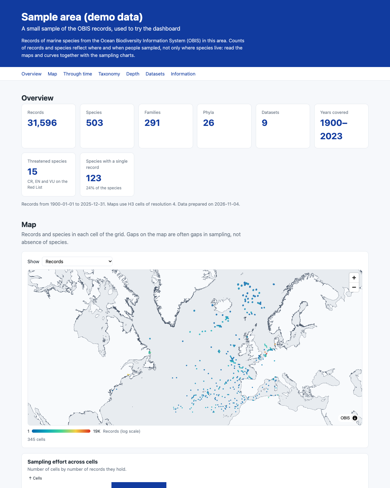

# OBIS dashboard

A simple, static dashboard that shows the results of **one full analysis for one
area** made with the [abra](../r-package) R package: overview numbers, a map of
the grid cells, records and species through time, taxonomy, depth, datasets and
the information metrics.

It has no server and no database. The analysis is done once in R and saved as
small [Parquet](https://parquet.apache.org) files; the page reads them directly in
the browser. So it can be hosted for free on GitHub Pages.



You do **not** need to know Svelte to use it. To make your own dashboard you only
change an R script (the area) and one settings file (the texts and colors).

A PDF version of the same analysis can be made with the [Quarto report](../quarto).

## Contents

1. [Try it](#1-try-it)
2. [Make your own dashboard](#2-make-your-own-dashboard)
3. [Publish it on GitHub Pages](#3-publish-it-on-github-pages)
4. [Settings](#settings-srclibconfigts)
5. [How it works](#how-it-works)
6. [Change or add sections](#change-or-add-sections)
7. [Troubleshooting](#troubleshooting)

## 1. Try it

You need [Node.js](https://nodejs.org) 20 or newer.

```sh
git clone https://github.com/iobis/abra.git
cd abra/dashboard
npm install
npm run dev
```

Open the address that is printed (http://localhost:5173). The repository includes
demo data (a small sample of OBIS records), so you will see a complete dashboard
straight away.

## 2. Make your own dashboard

**Step 1: run the analysis for your area.** Open [`prepare-data.R`](prepare-data.R)
and edit the settings at the top: the title, the area, the period, the taxa (if
you want only some groups, such as corals or fishes) and the size of the grid
cells. Then, from the `dashboard` folder:

```sh
Rscript prepare-data.R
```

This needs R, the [abra](../r-package) and [robisdb](https://github.com/iobis/robisdb)
packages, and a local copy of the OBIS open data (see
`robisdb::sync_opendata()`). It saves the results in `static/data/`.

**Step 2: change the texts and colors.** Edit
[`src/lib/config.ts`](src/lib/config.ts) (see [Settings](#settings-srclibconfigts)).

**Step 3: look at it.** Run `npm run dev` and open the page. Every time you run
`prepare-data.R` again, reload the page to see the new data.

## 3. Publish it on GitHub Pages

The workflow [`.github/workflows/deploy-dashboard.yml`](../.github/workflows/deploy-dashboard.yml)
builds the dashboard and publishes it. To use it:

1. Put your repository on GitHub and push your changes (including the files in
   `static/data`).
2. On GitHub, go to **Settings → Pages** and set **Source** to **GitHub Actions**.
3. Push to `main` (or run the workflow from the **Actions** tab). A minute later
   the dashboard is at `https://<your-user>.github.io/<repository>/`.

Notes:

- The address of the site is set automatically from the name of the repository.
  If you publish somewhere else (your own domain, another folder), set the
  environment variable `BASE_PATH` when building, for example
  `BASE_PATH=/dashboards/med npm run build`, or leave it empty for the root of a
  domain.
- If you move the `dashboard` folder to the root of its own repository, move the
  workflow to `.github/workflows/` there and delete the `working-directory` and
  `paths` lines that mention `dashboard`.
- To publish somewhere else, run `npm run build` and copy the `build` folder to
  any static web host (Netlify, an institutional server, ...).

## Settings (`src/lib/config.ts`)

| Setting | What it does |
|---|---|
| `title`, `subtitle` | Texts at the top. Empty: the ones from `prepare-data.R` are used. |
| `intro` | Short paragraph under the title (empty to hide it). |
| `dataPath` | Folder in `static/` with the Parquet files (default `data`). |
| `sections` | Sections to show, in order. Remove a line to hide a section. |
| `colors` | Main colors of the charts. |
| `map.metrics` | What the map can show: a column of `cells.parquet` and a label. |
| `map.log` | Logarithmic color scale (recommended for counts). |
| `map.style` | Basemap (a MapLibre style). The default uses the OBIS tiles. |
| `map.ramp` | Colors of the map, from low to high values. |
| `links` | Links in the footer. |

## How it works

```
prepare-data.R ──► static/data/*.parquet + meta.json ──► the page (Svelte) ──► charts, map, tables
   (R, abra)                                              reads them in the browser
```

`prepare-data.R` runs these analyses of abra and saves each one as a file:

| File | abra function | Shown in |
|---|---|---|
| `basic_stats` | `basic_stats()` | Overview |
| `cells` | `records_by_cell()` + `basic_stats(by = "cell")` | Map |
| `cell_histogram` | `cell_histogram()` | Map |
| `records_by_year`, `records_by_month` | `records_by_year()`, `records_by_month()` | Through time |
| `cumulative_species`, `cumulative_species_phylum` | `cumulative_species()` | Through time |
| `taxon_level`, `species_list` | `taxon_level()`, `species_list()` | Taxonomy |
| `depth_coverage`, `depth_bands` | `depth_coverage()`, `depth_bands()` | Depth |
| `datasets_by_extension`, `published_by_year` | `datasets_by_extension()`, `published_by_year()` | Datasets |
| `year_information`, `publication_information` | `year_information()`, `publication_information()` | Information |
| `meta.json` | – | Title, area, period, date |

A file that does not exist does not break the page: its chart just says that the
file is not available.

The page reads the files with [Hyparquet](https://github.com/hyparam/hyparquet),
which downloads only the parts of a file that it needs (HTTP range requests). This
matters for big files: the table of taxa, for example, loads only the first 1,000
rows and the rest on demand, so even a list of tens of thousands of taxa opens
quickly.

Libraries used: [SvelteKit](https://svelte.dev) (Svelte 5) with the static adapter,
[Hyparquet](https://github.com/hyparam/hyparquet) for Parquet,
[Observable Plot](https://observablehq.com/plot/) for charts,
[MapLibre GL](https://maplibre.org) for the map and
[deck.gl](https://deck.gl) for the H3 cells. The table is a small component
(search, sorting and pages) in `src/lib/components/DataTable.svelte`.

## Change or add sections

```
src/
├── lib/
│   ├── config.ts            ← settings
│   ├── data.ts              ← reading Parquet files
│   ├── sections/            ← one file per section of the page
│   └── components/          ← charts, map, table, ...
└── routes/+page.svelte      ← the page: lists the available sections
```

**Change a chart:** open the section in `src/lib/sections/` (for example
`TimeSection.svelte`). A chart looks like this:

```svelte
<Load file="records_by_year">
  {#snippet children(rows)}
    <PlotChart options={(width) => ({
      width,
      marks: [Plot.barY(rows, { x: 'date_year', y: 'n_records' })]
    })} />
  {/snippet}
</Load>
```

`Load` reads the file and gives its rows to the chart; `PlotChart` draws an
[Observable Plot](https://observablehq.com/plot/) chart, so anything in its
documentation works here.

**Add a section:**

1. Copy an existing file in `src/lib/sections/` and edit it.
2. In `src/routes/+page.svelte`, import it and add a line to `available`.
3. Add its id to `sections` in `src/lib/config.ts`.

**Add your own data:** write any table to `static/data/` as Parquet from R
(`arrow::write_parquet()`), then read it in a section with
`<Load file="my_table">`. Use small row groups (`chunk_size = 1000`) for big
tables.

## Troubleshooting

- **Empty page or "file not available"**: the Parquet files are not in
  `static/data/`. Run `prepare-data.R`.
- **The page works locally but is blank on GitHub Pages**: check that Pages uses
  *GitHub Actions* as source, and that the workflow finished (Actions tab).
- **No basemap**: the map downloads its tiles from `tiles.obis.org`; it needs
  internet. Change `map.style` to use another basemap.
- **The map is empty**: all cells have 0 for the chosen metric, or the
  `cells.parquet` file is missing.
- **A Parquet file does not open**: write it with `compression = "snappy"` (the
  default of `prepare-data.R`). Hyparquet does not read every compression format.

## Commands

| Command | |
|---|---|
| `npm run dev` | Development server with reload |
| `npm run build` | Builds the site in `build/` |
| `npm run preview` | Serves the built site |
| `npm run check` | Checks the code |
